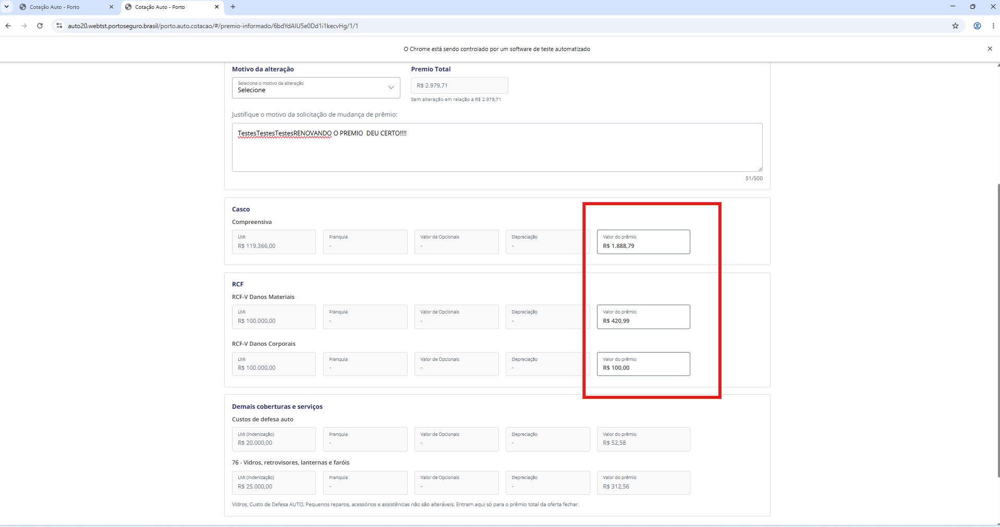

[BUG] Ausência de validação de valor limite nos campos "Valor do prêmio" gera estouro 500 Internal Server Error ao informar valores elevados (acima de 9 dígitos)

Description

[auto-cotacaobff-app / Frontend Web] Campos "Valor do prêmio" na tela de Prêmio Informado não possuem máscara/validação de valor limite máximo, retornando HTTP 500 ao preencher valores acima de 9 zeros

Na tela de alteração de Prêmio Informado (/porto.auto.cotacao/#/premio-informado/...), os campos editáveis "Valor do prêmio" das coberturas (Casco Compreensiva, RCF-V Danos Materiais, RCF-V Danos Corporais, etc.) aceitam o preenchimento de números arbitrariamente grandes sem aplicar uma trava/validação no Frontend ou tratamento amigável de validação de payload no Backend.

Ao informar valores extremamente altos (ex: valores acima de 999.999.999,00 / mais de 9 dígitos), ao submeter a alteração, a aplicação estoura com HTTP Status 500 Internal Server Error (estouro de precisão numérica no banco/DTO ou estouro de Data Overflow).

Impacto:

Prejudica a robustez e estabilidade da aplicação. O usuário recebe um erro genérico não tratado de servidor (500 Internal Server Error) em vez de ser orientado por uma mensagem de validação amigável de entrada (HTTP 400 Bad Request ou trava nativa de limite no campo).

Resultado Esperado vs Resultado Obtido
Resultado Esperado:

Frontend: O campo "Valor do prêmio" deve possuir restrição/máscara de limite máximo de entrada (ex: limite de até 9.999.999,99 ou equivalente ao padrão de cálculo da Porto), impedindo a digitação de valores fora da escala operacional.

Backend: Caso um valor excessivo ultrapasse a validação do Front, a API deve tratar a entrada e retornar HTTP Status 400 Bad Request com mensagem amigável (ex: "Valor do prêmio informado excede o limite máximo permitido"), evitando lançar exceções não tratadas (500).
