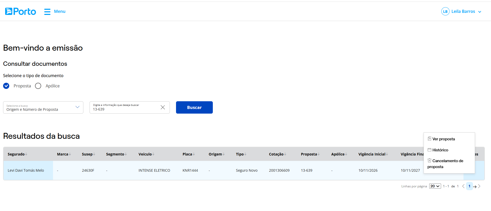

[TST] Liberação de pendências não exibe a tela da proposta

Quando na tela de consulta de documentos consultamos uma proposta pendente e selecionamos Ver proposta é exibida rapidamente a tela de de consulta da proposta e retorna a tela de consulta de documento.

Proposta 13-639

logs

[Explore-logs-2026-11-10 14_16_46.txt](Explore-logs-2026-11-10%2014_16_46.txt)
[Explore-logs-2026-11-10 14_16_22.txt](Explore-logs-2026-11-10%2014_16_22.txt)