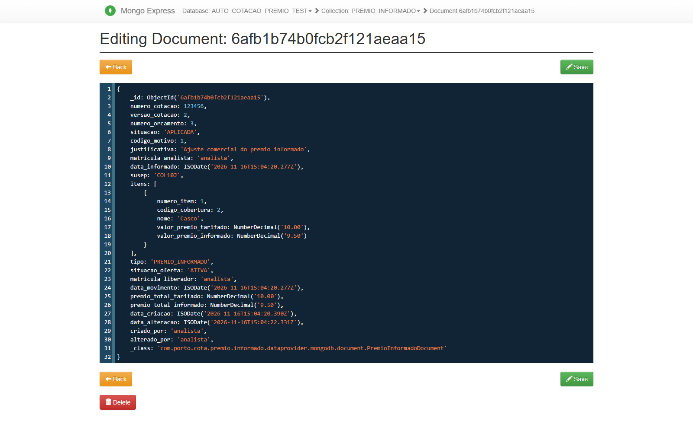
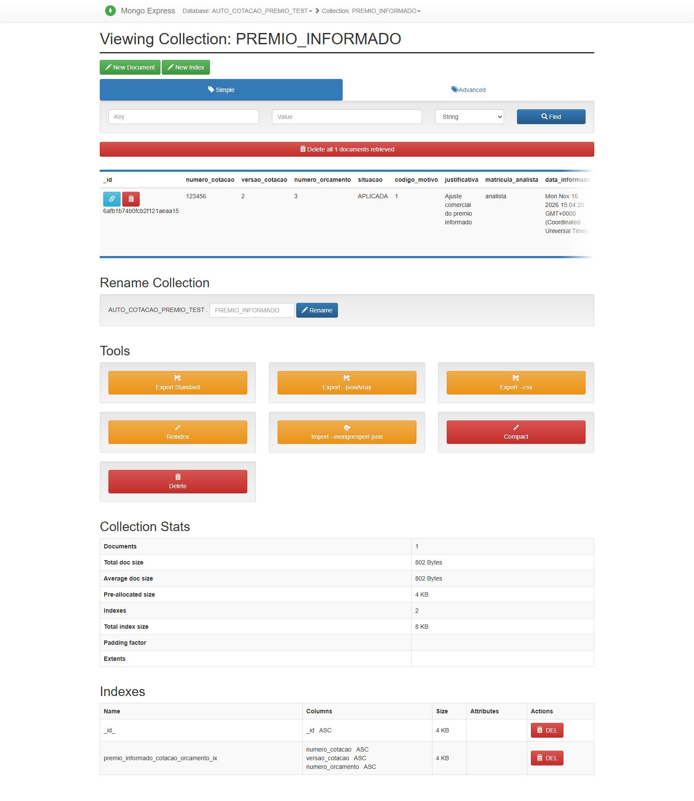

# Teste local — Prêmio Informado · Estado da oferta, totais e descarte no MongoDB

AUTOR3-32602 · Incluir os campos de controle de estado (situação, tipo), totais e auditoria de descarte no documento MongoDB do prêmio informado — primeira validação da implementação, com o build completo e o documento capturado do Mongo real do teste.

**Ambiente:** Docker 28.1.1 · MongoDB 7.0 (Testcontainers, porta dinâmica; nesta captura 62488) · mongo-express 1.0.2 temporário em `localhost:8091` · `sboot-auto-cota-premio-informado` branch `feature/AUTOR3-32602` (alterações não commitadas sobre `developer` @ `41fcdd7`) · parent `java-lib-auto-ecor-parent-sboot` 1.134.0-release · `java-lib-auto-cota-contratos` 1.275.0-release · OpenJDK 21.0.11 · Maven 3.9.9 (`settings_softvaro.xml`, offline) · profile `testepipeline`.

**Resultado:** os 5 critérios de aceite foram validados. O build completo (`clean verify`) passou com 92 testes unitários/ArchUnit e 15 de integração, sem falhas. Um `PUT /v1/ofertas/123456-2-3/premios` real passou pelo controller, pelo usecase, pelo Feign do cotacao-app (WireMock) e pelo MongoDB, e gravou o documento com `situacao_oferta=ATIVA`, `tipo=PREMIO_INFORMADO`, `data_movimento` igual à `data_informado`, os totais 10.00 / 9.50, `matricula_liberador` igual ao analista e nenhum dado de descarte. O documento foi capturado direto do Mongo durante o teste. As respostas do PUT e do GET seguem sem nenhum campo novo.

---

## 1. Infraestrutura

O serviço não usa RabbitMQ. A única infraestrutura do fluxo é o MongoDB, database `AUTO_COTACAO_PREMIO_TEST`, collection `PREMIO_INFORMADO`. Ele sobe por Testcontainers (`mongo:7.0`) a cada execução dos ITs, e o cotacao-app é simulado por WireMock. Para fotografar o documento antes de o container ser destruído, o cenário do PUT foi reexecutado isolado, com um detector `mongosh` em loop dentro do container e o mongo-express apontado para a porta dinâmica (`?directConnection=true`, porque o Mongo do Testcontainers sobe como replica set).

## 2. Caminho da gravação

```
ANTES
PUT /v1/ofertas/{c-v-o}/premios → AlterarPremioInformadoUseCaseImpl
   → salvar [situacao=PENDENTE]  → cotacao-app (Feign)  → atualizar [situacao=APLICADA|FALHA]
   documento: só o processamento da alteração, sem estado de oferta, totais ou descarte

AGORA
PUT /v1/ofertas/{c-v-o}/premios → AlterarPremioInformadoUseCaseImpl
   → monta o estado inicial: tipo=PREMIO_INFORMADO · situacao_oferta=ATIVA
                             data_movimento = data_informado · totais = Σ coberturas
                             matricula_liberador = analista · descarte = (ausente)
   → salvar [PENDENTE] → cotacao-app → atualizar [APLICADA]  (estado da oferta preservado)
```

## 3. Entrada

Payload do cenário (`src/test/resources/json/PremiosPutIT/payload-aplicacao.json`), enviado por um usuário com perfil de analista interno (principal `analista`):

```json
{
  "susep": "COL10J",
  "motivo": "AJUSTE_COMERCIAL",
  "justificativa": "Ajuste comercial do premio informado",
  "coberturas": [
    {
      "numeroItem": 1,
      "codigoCobertura": 2,
      "nome": "Casco",
      "valorPremioAnterior": 10.00,     ← soma vira premio_total_tarifado
      "valorPremioInformado": 9.50      ← soma vira premio_total_informado
    }
  ]
}
```

## 4. CA01 — Estado inicial e totais gravados no cadastro

Cena 1 — Documento recém-gravado na collection `PREMIO_INFORMADO` (mongo-express, `_id 6afb1b74b0fcb2f121aeaa15`). As linhas 21–26 mostram `tipo: 'PREMIO_INFORMADO'`, `situacao_oferta: 'ATIVA'`, `matricula_liberador: 'analista'`, `data_movimento` idêntica à `data_informado` (linha 10) e os totais `NumberDecimal('10.00')` e `NumberDecimal('9.50')`.



```
CONTEÚDO VERIFICADO (CA01) — documento 6afb1b74b0fcb2f121aeaa15
campo                    valor capturado                  ✔
situacao                 APLICADA                         ✔ (processamento, inalterado)
tipo                     PREMIO_INFORMADO                 ✔
situacao_oferta          ATIVA                            ✔
data_informado           2026-11-16T15:04:20.277Z         ✔
data_movimento           2026-11-16T15:04:20.277Z         ✔ (= data_informado)
premio_total_tarifado    NumberDecimal("10.00")           ✔ (Σ valor_premio_tarifado)
premio_total_informado   NumberDecimal("9.50")            ✔ (Σ valor_premio_informado)
```

Cena 2 — Visão da collection `PREMIO_INFORMADO` no mesmo instante: exatamente 1 documento (o do cenário), situação `APLICADA`, e o índice `premio_informado_cotacao_orcamento_ix` preservado.



Captura bruta do documento (`mongosh` dentro do container de teste): `mongo-premio-informado-cadastro.json`.

## 5. CA02 — Campos de descarte nulos na criação

No documento da Cena 1 não aparece a chave `descarte`, e o JSON capturado tem 22 chaves, nenhuma de descarte. O Spring Data não grava atributo nulo, então a ausência da chave é o null persistido.

```
CONTEÚDO VERIFICADO (CA02) — documento 6afb1b74b0fcb2f121aeaa15
campo                               valor capturado      ✔
descarte                            (ausente)            ✔
descarte.motivo_descarte            (ausente)            ✔
descarte.data_descarte              (ausente)            ✔
descarte.descartado_por.matricula   (ausente)            ✔
descarte.descartado_por.perfil      (ausente)            ✔
```

O IT reforça a mesma condição com `assertNull(gravado.getDescarte())` (`PremiosPutIT.deveAlterarPremioComFeignEMongo`, verde no log `build-put-isolado.log`).

## 6. CA03 — Restrição por enum

O CA03 é provado pelos testes, porque não depende de dado em banco. `tipo` e `situacao_oferta` são tipados com `TipoPremioInformadoEnum` e `SituacaoPremioInformadoEnum` no domínio e no documento. Os testes confirmam os valores exatos e a rejeição de valor fora do enum. O validador de persistência recusa gravar sem esses campos.

```
CONTEÚDO VERIFICADO (CA03) — build-sboot-auto-cota-premio-informado.log
classe                                   testes   resultado
TipoPremioInformadoEnumTest              2        ✔ (PREMIO_INFORMADO, FLEXIBILIZACAO; "RECALCULO" rejeitado)
SituacaoPremioInformadoEnumTest          2        ✔ (ATIVA, DESCARTADA; "APLICADA" rejeitado)
SalvaPremioInformadoImplTest             6        ✔ (inclui sem tipo / sem situação → DadosInvalidosException)
```

## 7. CA04 — Contrato de resposta inalterado

```
CONTEÚDO VERIFICADO (CA04) — build-sboot-auto-cota-premio-informado.log
cenário                                                     resultado
PremioInformadoGetIT (8 testes; 1 novo)                     ✔ Tests run: 8, Failures: 0
  registro com tipo/situacao_oferta/totais/descarte          ✔ resposta = consulta-aplicada-mais-recente.json (JSON estático de antes)
  campos tipo, situacaoOferta, matriculaLiberador,           ✔ ausentes no body
  dataMovimento, premioTotal*, descarte
PremiosPutIT (4 testes)                                     ✔ Tests run: 4, Failures: 0
  body do PUT sem os 7 campos novos                          ✔
  "situacao":"APLICADA" e orcamento devolvidos como antes    ✔
```

## 8. CA05 — Matrícula do liberador

```
CONTEÚDO VERIFICADO (CA05) — documento 6afb1b74b0fcb2f121aeaa15
campo                    valor capturado      ✔
matricula_analista       analista             ✔ (usuário autenticado)
matricula_liberador      analista             ✔ (= matricula_analista)
```

## 9. Comparativo antes × depois (documento gravado)

| Campo | Antes do card | Depois (capturado) |
|---|---|---|
| `situacao` | PENDENTE → APLICADA/FALHA | APLICADA (inalterado) |
| `tipo` | — | PREMIO_INFORMADO |
| `situacao_oferta` | — | ATIVA |
| `data_movimento` | — | = `data_informado` |
| `premio_total_tarifado` | — | 10.00 |
| `premio_total_informado` | — | 9.50 |
| `matricula_liberador` | — | analista |
| `descarte` | — | ausente (null) |

## 10. Resultado do build

```
build-sboot-auto-cota-premio-informado.log — mvn clean verify (profile testepipeline)
ArchUnitTest                              Tests run: 17, Failures: 0
AlterarPremioInformadoUseCaseImplTest     Tests run: 9,  Failures: 0
TotalPremioTest                           Tests run: 6,  Failures: 0
SalvaPremioInformadoImplTest              Tests run: 6,  Failures: 0
PremioInformadoDocumentMapperTest         Tests run: 3,  Failures: 0
PremioInformadoGetIT                      Tests run: 8,  Failures: 0
PremiosPutIT                              Tests run: 4,  Failures: 0
PremioInformadoToggleOffIT                Tests run: 3,  Failures: 0
Unitários: Tests run: 92, Failures: 0, Errors: 0, Skipped: 0
ITs:       Tests run: 15, Failures: 0, Errors: 0, Skipped: 0
BUILD SUCCESS · Total time: 16:18 min
```

**Não capturado:** a varredura de vulnerabilidades pedida no card. O build é offline e não tem scanner configurado, então ela fica para o pipeline do MR (Sonar/Dependency-Check).

## Como reproduzir neste ambiente

Build completo (prova principal), na pasta `sboot/sboot-auto-cota-premio-informado`:

```
C:\Users\jhonnyscerni\.sdkman\candidates\maven\3.9.9\bin\mvn.cmd -s C:\Users\jhonnyscerni\.m2\settings_softvaro.xml -o "-Dspring.profiles.active=testepipeline" clean verify
```

Captura do documento (cenário do PUT isolado, com o detector rodando em paralelo):

```
node captura.js <pasta-evidencias>      # (script salvo nesta pasta; requer o módulo playwright)
                                        # detecta o mongo:7.0 do Testcontainers, sobe o mongo-express
                                        # com ?directConnection=true, roda mongosh em loop e tira os prints
mvn.cmd -s ...settings_softvaro.xml -o "-Dspring.profiles.active=testepipeline" verify "-Dtest=NONE" "-Dsurefire.failIfNoSpecifiedTests=false" "-Dit.test=PremiosPutIT#deveAlterarPremioComFeignEMongo" "-Djacoco.skip=true"
```

O `-Djacoco.skip=true` é necessário só na execução isolada, porque o gate de cobertura do bundle falha com um subconjunto de ITs. Nenhum override foi gravado nos properties do repositório.
