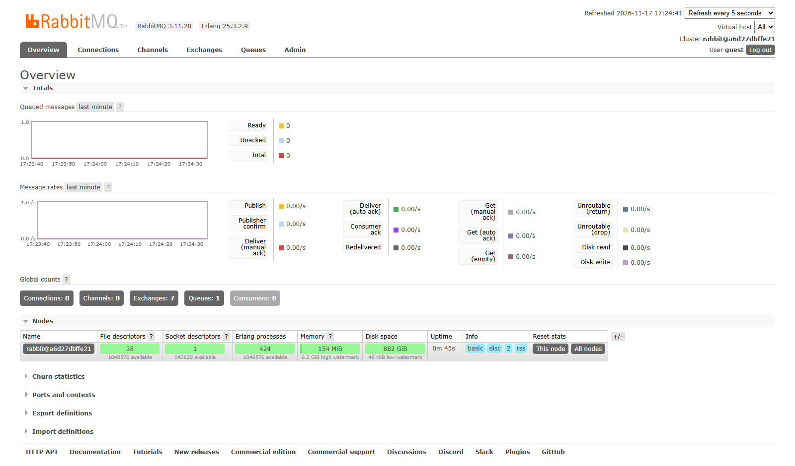
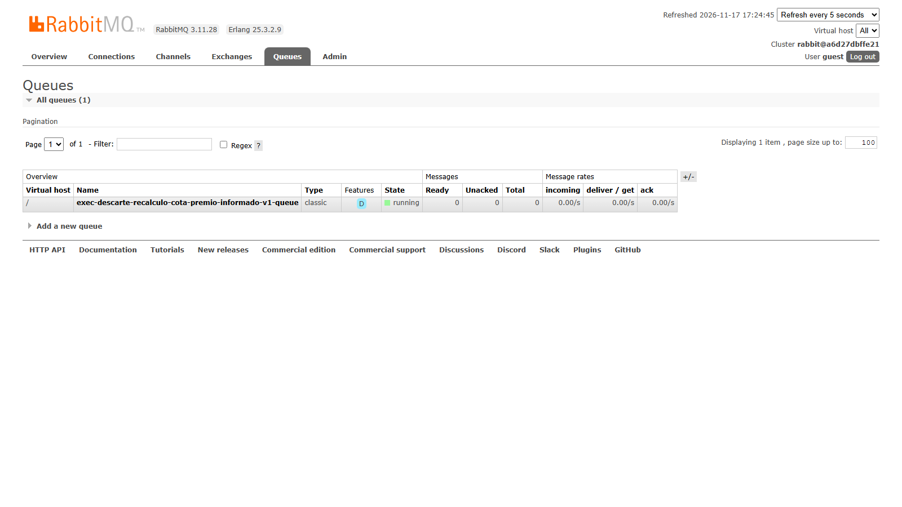
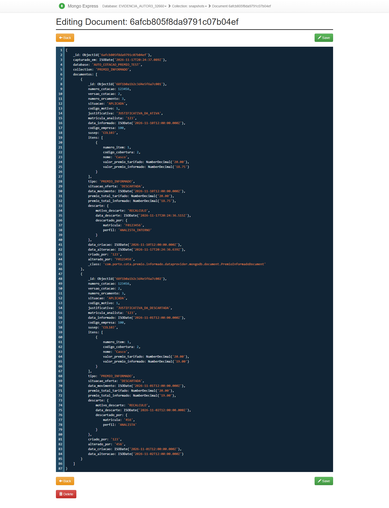
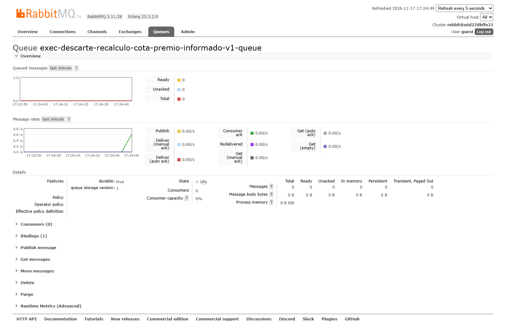

# Teste local — Prêmio Informado · Listener do evento de recálculo de oferta

**AUTOR3-32660** · [Monitoramento Prêmio Informado] - Criar Listener do Evento de Recálculo de Oferta - sboot-auto-cota-premio-informado. Primeira evidência do card, gerada após o commit `45b7bf0` (MR !17 → developer).

**Ambiente:** Docker 28.1.1 com Testcontainers: RabbitMQ 3.11.28 (`rabbitmq:3.11-management`, Erlang 25.3.2.9) e MongoDB 7.0.37 (`mongo:7.0`), em portas dinâmicas (na execução dos prints: AMQP 65463, management 65466, Mongo 65458). Serviço `sboot-auto-cota-premio-informado` na branch `feature/AUTOR3-32660`, commit `45b7bf0`, com parent `java-lib-auto-ecor-parent-sboot` 1.134.0-release. A `java-lib-auto-cota-contratos` está em `1794884581078-SNAPSHOT`, gerada da staging `adb46ed`, com `oferta-recalculada.yaml` e `premio-informado.yaml`. Build com Maven 3.9.9, Java 21.0.7 (Zulu) e profile `testepipeline`. Data: 17/11/2026.

**Resultado:** os 4 critérios de aceite foram validados e o `clean verify` completo terminou em BUILD SUCCESS, com 108 testes unitários e 18 ITs passando, sem falhas, e o `jacoco:check` atendido. A mensagem `OFERTA_RECALCULADA`, publicada na fila `exec-descarte-recalculo-cota-premio-informado-v1-queue`, foi consumida pelo `@RabbitListener`. O prêmio informado ATIVA da chave cotação 123456 / versão 2 / orçamento 3 passou para DESCARTADA no MongoDB, com motivo `RECALCULO`, a matrícula e o perfil do evento e a data de processamento. O registro que já estava descartado não mudou. O evento sem matrícula foi ignorado com WARN, sem exceção e sem reentrega.

## 1. Infraestrutura

O IT `DescarteRecalculoListenerIT` sobe broker e banco reais via Testcontainers, por meio do `TestcontainersRabbitInitializer` e do `TestcontainersMongoInitializer` da commons-test. A fila é declarada durável pelo `DescarteRecalculoItConfiguration`. Nos profiles de teste o listener fica com `auto-startup=false`, e o IT o liga com `spring.rabbitmq.listener.simple.auto-startup=true`.

Os dados persistidos foram capturados por um poller `mongosh` que roda dentro do container do Mongo. Ele lê a collection `AUTO_COTACAO_PREMIO_TEST.PREMIO_INFORMADO` a cada 20 ms e, a cada mudança de estado, grava uma cópia em `EVIDENCIA_AUTOR3_32660.snapshots`. A cópia é necessária porque o `@AfterEach` do IT dropa a collection logo depois da asserção.

Cena 1 — RabbitMQ Management do broker do Testcontainers (RabbitMQ 3.11.28), logo após o IT. A app já tinha encerrado a conexão (Connections 0, Consumers 0), e a fila ficou com Ready 0 / Unacked 0 / Total 0, ou seja, nenhuma mensagem ficou retida nem pendente de ack.



Cena 2 — Lista de filas do broker (17:24:45). Existe só a `exec-descarte-recalculo-cota-premio-informado-v1-queue`, classic e durável (D), no estado running, com Ready, Unacked e Total em 0.



## 2. Caminho da mensagem

```
auto-cotacao-app (publicador, outro card)
   │  OFERTA_RECALCULADA  (contrato: java-lib-auto-cota-contratos / api/oferta-recalculada.yaml)
   ▼
exec-descarte-recalculo-cota-premio-informado-v1-queue        (default-requeue-rejected=false)
   ▼
DescarteRecalculoListener.receber(OfertaRecalculadaEvento)    ── campo obrigatório nulo → WARN e return
   ▼
DescartarPremioInformadoPorRecalculoUseCaseImpl.descartar
   │  consulta por cotação + versão + orçamento, filtra situacao_oferta = ATIVA
   │  nenhum ATIVA → INFO e return
   ▼
MongoDB PREMIO_INFORMADO: situacao_oferta=DESCARTADA, descarte{RECALCULO, data, matrícula, perfil}, alterado_por
```

No IT, o publicador é o próprio `RabbitTemplate` do teste, que faz `send("", fila, mensagem)` com content-type `application/json`.

## 3. Entrada

Evento publicado (`evento-recalculo.json`):

```
{
  "tipo": "OFERTA_RECALCULADA",
  "numeroCotacao": 123456,          ← chave de busca
  "versaoCotacao": 2,               ← chave de busca
  "numeroOrcamento": 3,             ← chave de busca
  "matricula": "F0123456",          ← vira descarte.descartado_por.matricula e alterado_por
  "perfil": "ANALISTA_INTERNO",     ← vira descarte.descartado_por.perfil
  "dataHoraRecalculo": "2026-11-16T10:00:00-03:00"
}
```

Massa carregada no Mongo (`ATIVA_E_DESCARTADA.json`): dois registros da mesma chave. O `…c001` está ATIVA, com alterado_por 123. O `…c002` já estava DESCARTADA desde 02/11 pela matrícula 456, perfil ANALISTA.

## 4. CA01 / CA02 — ATIVA → DESCARTADA por RECALCULO, com data e responsável

Estado capturado antes do processamento (snapshot `6afcb804…ee`, 20:24:36.616Z), registro `…c001`:

```
situacao_oferta : ATIVA
descarte        : (ausente)
alterado_por    : 123
data_alteracao  : 2026-11-10T12:00:00Z
```

Log da aplicação (`build-captura-DescarteRecalculoListenerIT.log:221`):

```
17:24:36.723 [INFO ] DescartarPremioInformadoPorRecalculoUseCaseImpl - Premio informado descartado por recalculo. id=68f1b0a1b2c3d4e5f6a7c001, cotacao=123456, versao=2, orcamento=3
```

Cena 3 — mongo-express mostrando o snapshot `6afcb805f8da9791c07b04ef`, capturado às 20:24:37.089Z na collection `AUTO_COTACAO_PREMIO_TEST.PREMIO_INFORMADO`. O registro `…c001` está com `situacao_oferta: 'DESCARTADA'` e `descarte.motivo_descarte: 'RECALCULO'`, com matrícula F0123456 e perfil ANALISTA_INTERNO. O registro `…c002` permanece com o descarte original de 02/11.



```
CONTEÚDO VERIFICADO (CA01 / CA02) — registro 68f1b0a1b2c3d4e5f6a7c001
campo                                  | valor                          |
---------------------------------------+--------------------------------+---
situacao_oferta                        | DESCARTADA                     | ✔
descarte.motivo_descarte               | RECALCULO                      | ✔
descarte.data_descarte                 | 2026-11-17T20:24:36.515Z       | ✔ (momento do processamento)
descarte.descartado_por.matricula      | F0123456                       | ✔ (= evento.matricula)
descarte.descartado_por.perfil         | ANALISTA_INTERNO               | ✔ (= evento.perfil)
alterado_por                           | F0123456                       | ✔
data_alteracao                         | 2026-11-17T20:24:36.639Z       | ✔
criado_por / data_criacao              | 123 / 2026-11-10T12:00:00Z     | ✔ (preservados)
itens / prêmios totais                 | 20.00 / 18.75                  | ✔ (preservados)
```

`data_descarte` é a data da recepção e não a `dataHoraRecalculo` do evento. Ela é marcada no início do processamento (36.515), antes da gravação (36.639). O IT compara o documento inteiro com o JSON estático `esperado-descartada-por-recalculo.json` e só ignora essas duas datas, que são dinâmicas.

## 5. CA03 — Sem prêmio ATIVA: nada muda e nenhuma exceção sobe

Teste `nao_deve__alterar__quando__nao_ha_premio_ativo`: a massa `SOMENTE_DESCARTADA.json` tem só o registro `…c002`, já descartado. O mesmo evento foi publicado.

```
17:24:39.019 [INFO ] DescartarPremioInformadoPorRecalculoUseCaseImpl - Nenhum premio informado ativo para descarte por recalculo. cotacao=123456, versao=2, orcamento=3
```

```
CONTEÚDO VERIFICADO (CA03) — snapshot 6afcb807f8da9791c07b04f1 (20:24:39.246Z), registro 68f1b0a1b2c3d4e5f6a7c002
campo                                  | valor                          |
---------------------------------------+--------------------------------+---
situacao_oferta                        | DESCARTADA                     | ✔ (inalterado)
descarte.descartado_por                | 456 / ANALISTA                 | ✔ (inalterado, não sobrescrito por F0123456)
descarte.data_descarte                 | 2026-11-02T12:00:00Z           | ✔ (inalterado)
alterado_por / data_alteracao          | 456 / 2026-11-02T12:00:00Z     | ✔ (inalterado)
mudanças posteriores no poller         | nenhuma até o drop do cleanup  | ✔
```

## 6. Exceção — evento sem campo obrigatório (matrícula)

Teste `nao_deve__alterar__quando__evento_sem_matricula`: a massa `ATIVA_E_DESCARTADA.json` foi publicada com `evento-sem-matricula.json`.

```
17:24:37.532 [WARN ] DescarteRecalculoListener - Evento de recalculo de oferta ignorado por dados obrigatorios ausentes: class OfertaRecalculadaEvento {
    tipo: OFERTA_RECALCULADA
    numeroCotacao: 123456
    versaoCotacao: 2
    numeroOrcamento: 3
    matricula: null
    perfil: ANALISTA_INTERNO
    dataHoraRecalculo: 2026-11-16T13:00Z
}
```

```
CONTEÚDO VERIFICADO (Exc-01) — snapshot 6afcb805f8da9791c07b04f0 (20:24:37.880Z), registro 68f1b0a1b2c3d4e5f6a7c001
campo                                  | valor                          |
---------------------------------------+--------------------------------+---
situacao_oferta                        | ATIVA                          | ✔ (não descartado)
descarte                               | (ausente)                      | ✔
alterado_por / data_alteracao          | 123 / 2026-11-10T12:00:00Z     | ✔ (inalterado)
mudanças posteriores no poller         | nenhuma até o drop do cleanup  | ✔
```

## 7. CA04 — Fluxo direto, sem retry nem DLQ

Cena 4 — Fila `exec-descarte-recalculo-cota-premio-informado-v1-queue` no management (17:24:49), logo após o IT. No gráfico do último minuto aparece o pico das mensagens do teste: Publish 0,60/s, Deliver (manual ack) 0,60/s, Consumer ack 0,60/s e Redelivered 0,00/s. Ready, Unacked e Total estão em 0, a fila é `durable: true` e não há policy nem DLX.



Contadores da fila consultados na API de management (`execucao-2-captura/rabbit-fila-apos-descarte.json`, execução do `verify` completo, capturados 3 s após o descarte):

```
CONTEÚDO VERIFICADO (CA04) — exec-descarte-recalculo-cota-premio-informado-v1-queue
campo                    | valor  |
-------------------------+--------+---
durable                  | true   | ✔
arguments (DLX/TTL)      | {}     | ✔ (sem DLQ, conforme RN07)
publish                  | 2      | ✔
deliver                  | 2      | ✔
ack                      | 2      | ✔ (toda mensagem entregue foi confirmada)
redeliver                | 0      | ✔ (sem reentrega)
messages (prontas)       | 0      | ✔
```

O broker amostra os contadores em intervalos de 5 s. Por isso a coleta registrou 2 das 3 mensagens publicadas pelo IT. O que importa para o CA04 vale para todas as que foram amostradas: cada entrega teve ack, nenhuma foi reentregue e a fila terminou vazia, inclusive com o evento sem matrícula, que foi consumido e não rejeitado. Na execução dos prints, a consulta à API foi feita antes da primeira amostragem (`message_stats` vazio). Por isso os contadores absolutos acima são os da execução 2, e as taxas da execução dos prints estão na Cena 4.

## 8. Comparativo por cenário

| Campo (registro `…c001`, salvo indicação) | Antes (massa) | Happy path (CA01/CA02) | Sem matrícula (Exc-01) | Sem ATIVA (CA03, `…c002`) |
|---|---|---|---|---|
| situacao_oferta | ATIVA | **DESCARTADA** | ATIVA | DESCARTADA (inalterado) |
| descarte.motivo_descarte | — | **RECALCULO** | — | RECALCULO (de 02/11) |
| descarte.descartado_por | — | **F0123456 / ANALISTA_INTERNO** | — | 456 / ANALISTA |
| alterado_por | 123 | **F0123456** | 123 | 456 |
| Log | — | INFO "descartado por recalculo" | WARN "ignorado por dados obrigatorios ausentes" | INFO "Nenhum premio informado ativo" |

## 9. Testes executados

`clean verify` completo (`build-sboot-auto-cota-premio-informado.log`, 08:28 min):

```
Unitários (surefire): Tests run: 108, Failures: 0, Errors: 0, Skipped: 0
  DescartarPremioInformadoPorRecalculoUseCaseImplTest  5
  DescarteRecalculoListenerTest                        7
  DescarteRecalculoDtoMapperTest                       2
ITs (failsafe):       Tests run: 18, Failures: 0, Errors: 0, Skipped: 0
  PremioInformadoGetIT                                 8
  PremioInformadoToggleOffIT                           3
  PremiosPutIT                                         4
  DescarteRecalculoListenerIT                          3   (28.98 s)
jacoco:check — All coverage checks have been met.
BUILD SUCCESS
```

O mesmo resultado (108 + 18, BUILD SUCCESS em 03:03 min) já tinha saído numa primeira execução, registrada em `build-sboot-auto-cota-premio-informado-execucao-1.log`. Os prints e os snapshots do Mongo das seções 4 a 6 são de uma terceira execução, filtrada no `DescarteRecalculoListenerIT` (3/3, BUILD SUCCESS, `build-captura-DescarteRecalculoListenerIT.log`). Ela foi necessária porque os containers do Testcontainers são removidos ao fim da JVM. A execução 2 também capturou os mesmos estados no Mongo (`execucao-2-captura/mongo-snapshots.log`).

## 10. Como reproduzir neste ambiente

```
cd sboot/sboot-auto-cota-premio-informado
git checkout feature/AUTOR3-32660            # 45b7bf0

# suíte completa (Docker ativo; Testcontainers sobe Rabbit e Mongo em portas dinâmicas, sem overrides)
~/.sdkman/candidates/maven/3.9.9/bin/mvn.cmd -s ~/.m2/settings_softvaro.xml \
  -Dspring.profiles.active=testepipeline clean verify

# só o IT do listener
~/.sdkman/candidates/maven/3.9.9/bin/mvn.cmd -s ~/.m2/settings_softvaro.xml \
  -Dspring.profiles.active=testepipeline -Dtest=none -Dsurefire.failIfNoSpecifiedTests=false \
  -Dit.test=DescarteRecalculoListenerIT -Djacoco.skip=true clean verify

# acompanhar o Mongo durante o IT (no container mongo:7.0 criado pelo Testcontainers)
docker exec <container-mongo> mongosh --quiet AUTO_COTACAO_PREMIO_TEST \
  --eval "EJSON.stringify(db.PREMIO_INFORMADO.find().toArray(), {relaxed:true})"
```

## Arquivos

- `build-sboot-auto-cota-premio-informado.log`: `clean verify` completo (execução 2)
- `build-sboot-auto-cota-premio-informado-execucao-1.log`: `clean verify` completo (execução 1)
- `build-captura-DescarteRecalculoListenerIT.log`: execução filtrada usada para os prints
- `mongo-snapshots.log`: todos os estados da collection durante a execução dos prints
- `rabbit-fila-apos-descarte.json`, `containers.json`, `orquestrador.log`: capturas da execução dos prints
- `execucao-2-captura/`: snapshots do Mongo e contadores da fila da execução 2
- `print-rabbit-overview.png`, `print-rabbit-filas.png`, `print-mongo-snapshot-descarte.png`, `print-rabbit-fila-descarte-recalculo.png`: Cenas 1 a 4
